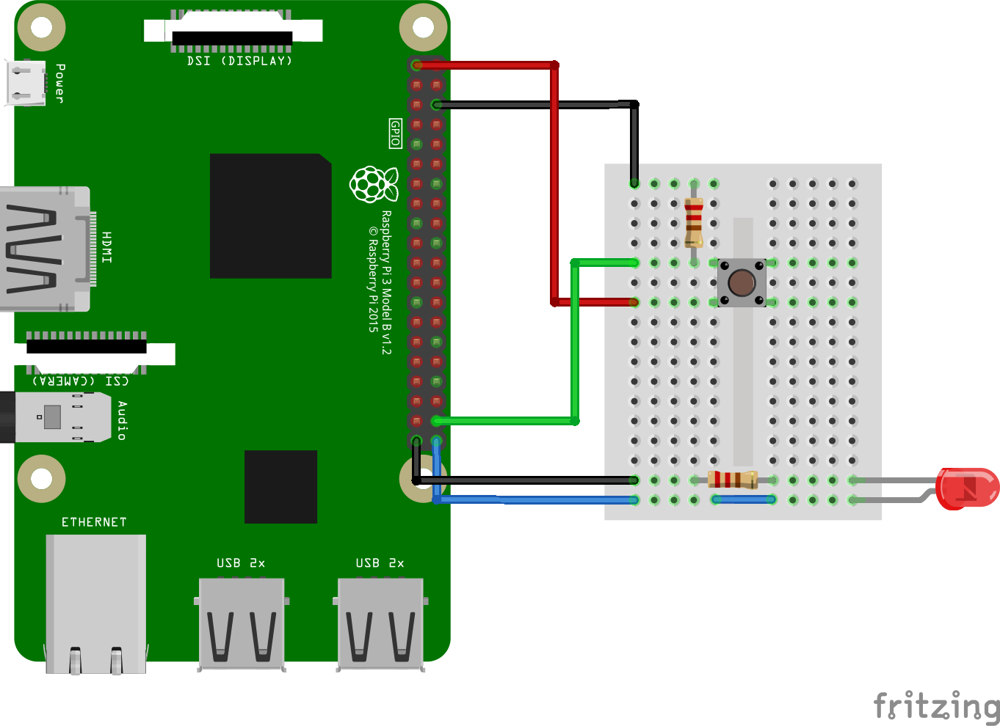

# 26_sysfs_attr

In this lecture you will learn how to use sysfs device attributes as an interface between a kernel driver and userspace.

This example can be compiled and run on a Raspberry Pi. The driver should also work on other ARM based platforms but the device tree overlay must be adopted.

## Hardware setup

The LED is connected to GPIO21, the button to GPIO20.

## Linux sysfs

sysfs is a virtual filesystem on Linux. It is mounted under `/sys/`. If we take a look to this folder we see a bunch of different other folders and inside the folders files. These files and folders only "live" while the Linux system is up and running. If we power off the system and put the SD card into a PC, we will see the sys folder is empty or almost empty. All folders and files in `/sys/` are interfaces between the kernel and its drivers and the userspace.

sysfs device attributes are represented as files in `/sys/`. They can be readable and/or writable.  If they are read, a *show* callback function is called in the driver. On write, a *store* callback function is called.

Let's add two device attributes to our platform device and control an LED and read in the state of a button over them.

## show callback for the button

Let's implement the `button_show` callback which will be invoked when reading from the device attribute. The function returns the amount of bytes which were read. The first argument is a pointer to the device belonging to the device attribute. The second one a pointer to the device attribute. The last argument is a string in which the driver callback will write the data which will be read by the userspace. There is no argument specifying the size of the string because the size is fixed to `PAGE_SIZE` amount of bytes. On Linux a page is typically 4kB in size.

Now we need to retrieve the driver's device data which was set in the probe function and contains pointers to the LED and buttons GPIOs. With `to_platform_device` we get the `platform_device` pointer from the device pointer. Then we can retrieve the driver's device data with `platform_get_drvdata`.

For reading in the state of the button, a function of the GPIOD API is used. 

`sysfs_emit` is a function which formats the output string. It allows us to use `printf` like formatting and returns the length of the formatted string.

## store callback for the LED

The store callback `led_store` has the same first two arguments. But as the data is written from userspace to kernelspace, the string is now a constant and the last argument specifies the amount of bytes written to the device attribute. The return value is the amount of bytes successfully written.

## Device attribute macros

To create device attributes, the following macros are available:

- `DEVICE_ATTR_RO`: Creates a read only device attribute
- `DEVICE_ATTR_WO`: Creates a write only device attribute
- `DEVICE_ATTR_RW`: Creates a read- and writable device attribute

Let's take a look at the macro `DEVICE_ATTR_RO(button)`. This gets expanded to the following:

~~~
struct device_attribute dev_attr_button = {
	.attr	= { .name = button, .mode = 0444 },
	.show	= button_show,
}
~~~

So, a device attribute with the name `dev_attr_button` is created. The permissions are set to read only for all (`0444`) and the attribute should use `button_show` as a read callback.

## Adding & removing the device attributes

The function `device_create_file` adds a device attribute (second argument) to a device (first argument). In the probe function of the platform device, we add the two attributes `dev_attr_button` and `dev_attr_led`. The function returns zero on success, a negative error code else.

In the remove function, `device_remove_file` is called to remove the device attributes.

Our platform device is represented in the `sysfs` under `/sys/bus/platform/devices/[device name]`. In the device tree we are adding the device `my_device`, therefore the device attributes `led` and `button` will be created in `/sys/bus/platform/devices/my_device/`.

## Testing

~~~
# Compile the code and the dt overlay
$ make

# Insert the dt overlay
$ sudo dtoverlay my_overlay.dtbo

# Check the platform device for files
$ ls /sys/bus/platform/devices/my_device/
driver_override  modalias  of_node  power  subsystem  supplier:platform:fe200000.gpio  uevent

# Load driver
$ sudo insmod my_dev_driver.ko

# Check the platform device for files again
$ ls /sys/bus/platform/devices/my_device/
button  driver  driver_override  led  modalias  of_node  power  subsystem  supplier:platform:fe200000.gpio  uevent

# led & button are the device attributes
$ ls -l /sys/bus/platform/devices/my_device/{led,button}
-r--r--r-- 1 root root 4096 Nov  3 20:58 /sys/bus/platform/devices/my_device/button
--w------- 1 root root 4096 Nov  3 20:58 /sys/bus/platform/devices/my_device/led

# Writing a 1 to led turns on the LED
$ echo 1 | sudo tee /sys/bus/platform/devices/my_device/led
# LED is on

$ echo 0 | sudo tee /sys/bus/platform/devices/my_device/led
# LED is off

# Reading button gives us the state of the button
$ cat /sys/bus/platform/devices/my_device/button
Button is [not ]pressed!

# Remove the dt overlay
$ sudo dtoverlay -R my_overlay

# Unload the driver
$ sudo rmmod my_dev_driver
~~~
